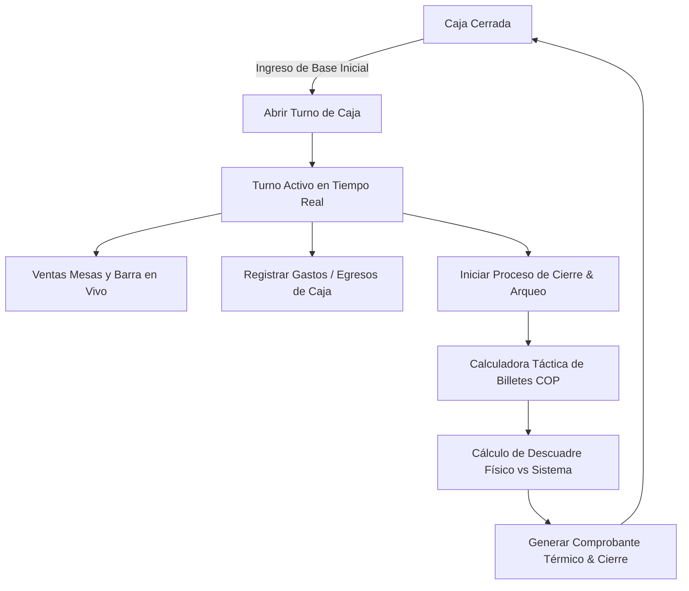

# Propuesta: Módulo de Caja & Arqueo de Turno
**Sistema de Gestión - Club de Billar & Café Bar "El Encuentro Tocano"**

---

## 1. Propósito y Fin del Módulo
En un negocio de billar y bar, el flujo de dinero combina cobros por **tiempo fraccionado en mesas** y **consumos de barra**, junto a entradas y salidas de efectivo constantes (compras de hielo, pago a proveedores de pasabocas, propinas, etc.).

El módulo de **Caja y Arqueo** tiene como objetivos esenciales:
1. **Control estricto de Turno**: Obligar el registro de la base física inicial antes de operar y facturar.
2. **Arqueo Ciego y Detección de Descuadres**: Comparar el dinero físico contado por el cajero contra el saldo calculado por el sistema, determinando si hay **cuadre exacto**, **faltante** (en rojo) o **sobrante** (en azul/verde).
3. **Registro de Egresos Menores**: Registrar gastos en efectivo con descripción obligatoria para justificar salidas de dinero sin generar descuadre en caja.
4. **Desglose por Medios de Pago**: Separar ingresos en **Efectivo Físico**, **Transferencias (Nequi / Daviplata)** y **Datáfono / Tarjetas**.
5. **Comprobante Térmico de Cierre**: Emitir el ticket físico/digital con el balance del turno para archivo contable y firmas del cajero y administrador.

---

## 2. Arquitectura de Pantallas y Flujos

---

## 3. Especificación Detallada de la Interfaz

### A. Estado 1: Caja Cerrada (Apertura de Turno)
* **Diseño visual:** Centrado y limpio, con contenedor `rounded-2xl`, branding con logo oficial de Tocancipá y acento verde billar `#184A35`.
* **Configuración de base:** Input para ingresar el monto en efectivo físico de base, con botones rápidos de denominación (`$50.000`, `$100.000`, `$200.000`).
* **Acción principal:** Botón `[ 🔓 Abrir Turno de Caja ]` en `#184A35`.

---

### B. Estado 2: Turno Activo (Panel de Control Financiero)
* **Cinta superior de auditoría:**
  - Cajero responsable en turno.
  - Hora exacta de apertura y cronómetro de duración de la jornada.
  - Indicador de estado: `🟢 Turno Operativo`.
* **4 Tarjetas KPI Superiores:**
  1. **Total Facturado en el Turno**: Suma consolidada de mesas y consumos de bar.
  2. **Efectivo Físico Esperado**: `Base Inicial + Cobros en Efectivo - Gastos/Egresos`.
  3. **Transferencias Digitales**: Subtotal recaudado vía Nequi y Daviplata.
  4. **Gastos / Egresos Registrados**: Salidas menores de caja para compras operativas.
* **Barra de Acciones Inmediatas:**
  - `[ 💸 Registrar Salida / Gasto Menor ]`: Modal rápido para egresos en efectivo con concepto y comprobante.
  - `[ 🔒 Realizar Arqueo y Cerrar Turno ]`: Inicia el proceso de liquidación final.

---

### C. Calculadora Táctica de Billetes (Arqueo Físico Colombiano)
Para evitar el uso de calculadoras externas y errores humanos, se proveerá un panel de conteo táctil por denominación nacional:
* Billetes: `$100.000`, `$50.000`, `$20.000`, `$10.000`, `$5.000`, `$2.000`.
* Monedas: Total en monedas sueltas.
* **Cálculo automático:** La suma de todas las denominaciones calcula el total declarado en tiempo real.

---

### D. Modal de Cierre y Liquidación Final
* **Comparativa en vivo:**
  - Efectivo esperado por sistema vs. Efectivo físico contado.
  - Resultado: `Cuadrada`, `Faltante: -$XX.XXX` o `Sobrante: +$XX.XXX`.
* **Campo de Observaciones:** Justificación obligatoria si existe diferencia en dinero.
* **Botones:** `[ Cancelar ]` y `[ Confirmar Cierre Definitivo ]`.

---

### E. Comprobante Térmico de Cierre (Imprimible)
* Formato idéntico a una tirilla térmica de 80mm:
  - Encabezado: Logo **El Encuentro Tocano**, NIT y fecha/hora.
  - Resumen de ingresos: Mesas vs. Barra.
  - Desglose por método de pago: Efectivo, Nequi, Daviplata, Tarjetas.
  - Balance de caja: Base inicial, egresos, saldo esperado, saldo contado y diferencia.
  - Espacio de firmas: *Firma Cajero* y *Firma Administrador*.
